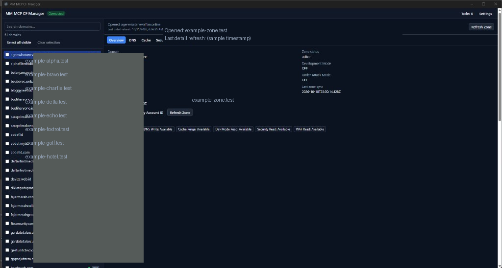
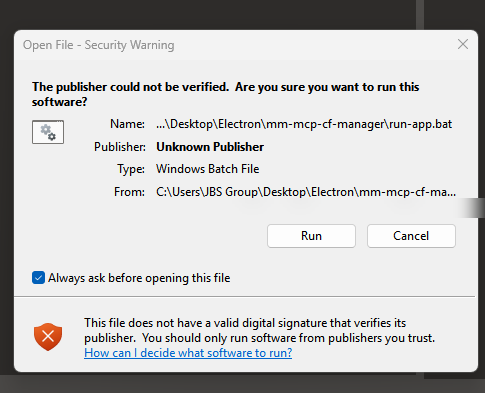

# MM MCP CF Manager

Unofficial desktop control panel for managing Cloudflare zones via the official Cloudflare MCP server (`https://mcp.cloudflare.com/mcp`).

**License:** MIT  
**UI language:** English  
**Repository:** [github.com/itcomindo/mm-mcp-cf-manager](https://github.com/itcomindo/mm-mcp-cf-manager)

This application is not affiliated with or endorsed by Cloudflare, Inc.

## Development transparency

This repository was built with [Cursor](https://cursor.com/) as the primary IDE. Implementation work—including scaffolding, feature work, and documentation—was done with **Cursor Composer 2.5** (AI-assisted editing) guided by [MM-MCP-CF-Manager-Blueprint.md](MM-MCP-CF-Manager-Blueprint.md) and in-repo rules (MCP-only Cloudflare access, no credential logging, typed IPC).

Human direction and review still apply: verify changes locally (`npm run test`, `npm run typecheck`, `npm run lint`) before trusting writes against live zones. Cursor and Composer are development tools only; they do not operate your Cloudflare account or endorse this project.

## Features

- **Connection** — Save API token (OS-encrypted), test via `whoami`, sync zone list with multi-account pagination; zones cached in local SQLite
- **Sidebar** — Search domains, multi-select for bulk actions, Dev/UAM badges, per-zone detail-refresh indicators, resizable width (288–560px, saved in settings)
- **Per zone** — Overview, DNS, Cache, Security, WAF, and Activity tabs
- **Sync vs refresh** — **Sync Zones** (Settings → Connection) updates the domain list only; **Refresh Zone** (header or bulk **Refresh zone detail**) fetches live capabilities, settings, and Dev/UAM state for selected or opened zones
- **Writes** — Cache purge and development mode, Under Attack mode, DNS CRUD, WAF rule CRUD/toggle; gated by detected token capabilities, optional confirmations, and **Dry Run** (Settings → Behavior)
- **Bulk actions** — Purge Everything, development mode ON/OFF, Under Attack ON/OFF, refresh zone detail for selected zones; preview dialog and **Tasks** drawer with bounded concurrency and cancel-remaining
- **Settings** — Appearance, behavior, data folder, **IP whitelist** (account-level IP Access Rules that apply to all zones on the account)

All Cloudflare calls go through reviewed MCP `execute` templates in the main process — not direct REST from the renderer.

## Screenshots

Main window (domain names redacted for privacy):



First launch on Windows — SmartScreen may warn because `run-app.bat` is not code-signed:



To regenerate redacted images after updating UI captures, place originals in `docs/screenshots/source/` and run `python scripts/redact-screenshots-for-readme.py` (requires Pillow). Do not commit unredacted sources.

## Requirements

- [Node.js 24 LTS](https://nodejs.org/) or newer (on PATH for Desktop shortcut launches)
- Windows 11 (primary target for v1)

## Install and run

```bash
git clone https://github.com/itcomindo/mm-mcp-cf-manager.git
cd mm-mcp-cf-manager
npm install
```

1. Double-click `create-desktop-shortcut.bat` to create a Desktop shortcut.
2. Launch **MM MCP CF Manager** from the Desktop (`run-app.bat` prepares and starts the app).

The launcher may show a brief Command Prompt window while preparing; it closes when the app window opens. Logs: `%LOCALAPPDATA%\MM-MCP-CF-Manager\launcher.log` and the app `userData` `logs/` folder (path in Settings → About).

### Development

```bash
npm run dev
npm run test
npm run lint
npm run typecheck
```

## API token permissions

Create a custom token in the [Cloudflare dashboard](https://dash.cloudflare.com/profile/api-tokens). Suggested permissions for the full app:

| Scope | Permission | Use in app |
| ----- | ---------- | ---------- |
| User | User Details → Read | Test connection |
| Account | Account Firewall Access Rules → Read | Settings → IP whitelist (list) |
| Account | Account Firewall Access Rules → Edit | Settings → IP whitelist (add/remove) |
| Account | Account WAF → Edit | WAF custom rules (as allowed by your plan) |
| Zone | Zone → Read | Sync zones |
| Zone | Zone Settings → Edit | Development mode, Under Attack mode, security reads/writes |
| Zone | Cache Purge → Purge | Purge cache and development mode changes |
| Zone | DNS → Edit | DNS create, update, delete |

For read-only inspection, start with **Zone Read** plus read scopes for DNS/cache/security/WAF as needed. Add write permissions when you enable mutations. Never commit tokens to the repository.

## Troubleshooting

**Windows “Open File — Security Warning” (Unknown Publisher)** — Expected for v1: the app ships as a local folder plus `run-app.bat`, not a signed installer. Windows SmartScreen cannot verify a publisher on batch files downloaded from GitHub or copied from the internet (Mark of the Web). Click **Run** only if you trust this repository; use **Cancel** if you did not clone it yourself. To reduce prompts, clone from GitHub and run from that folder, or unblock the file in Properties → **Unblock** (advanced). A signed MSI/NSIS installer is out of scope for v1 (see blueprint).

**“Preload bridge not available”** — The UI loaded without `window.mmcf`. Close the app, run `run-app.bat` from the project folder (or recreate the shortcut with `create-desktop-shortcut.bat` after updates). Check `%LOCALAPPDATA%\MM-MCP-CF-Manager\launcher.log` for `[main boot]` and prepare errors. Ensure Node.js **24+** is on PATH. If built files are missing, run `npm run build` or let `run-app.bat` run `app:prepare`. For hot reload, use `npm run dev` instead of the Desktop shortcut.

## Specification

Full product spec, architecture, and phase history: [MM-MCP-CF-Manager-Blueprint.md](MM-MCP-CF-Manager-Blueprint.md)

## License

MIT — see [LICENSE](LICENSE).
